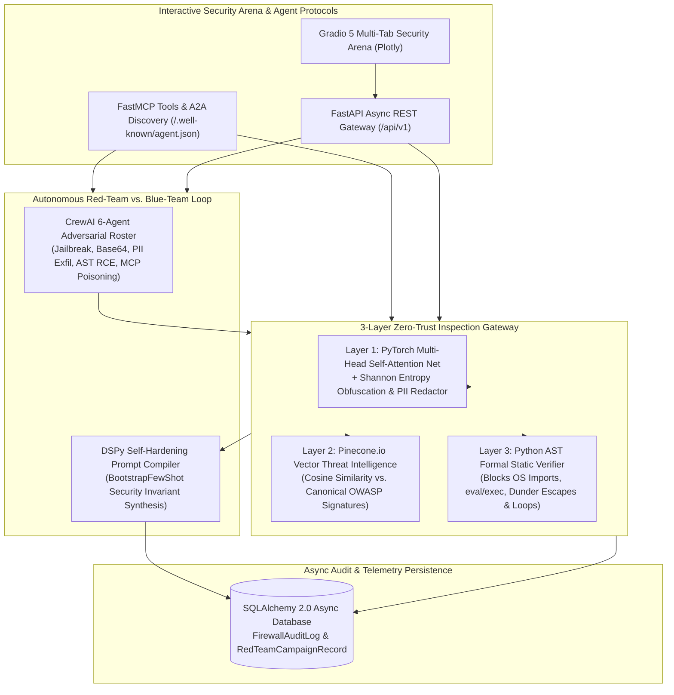

# 🛡️ Neural Zero-Trust AI Firewall & Autonomous Red-Team Arena


An end-to-end **Zero-Trust AI Security Gateway & Autonomous Red-Team vs. Blue-Team Arena** engineered to protect production LLM agents against **OWASP LLM Top-10** threats. The platform combines a **PyTorch Multi-Head Self-Attention** neural threat classifier, **Shannon Entropy** obfuscation detection, **Pinecone.io** vector threat signature matching, a **Formal Python AST Static Sandbox**, **CrewAI** adversarial red-teaming, and a **DSPy** self-hardening prompt compiler.

---

## 🏗️ Multi-Layer Zero-Trust Security Architecture



---

## 🔬 Mathematical Foundations & Verification Engines

### 1. PyTorch Multi-Head Self-Attention & Shannon Entropy (`app/security/pytorch_neural_guard.py`)
Incoming prompts are tokenized into tensor sequences $\mathbf{X} \in \mathbb{R}^{B \times L \times D}$ ($D = 64$) and passed through a custom `torch.nn.Module` (`SelfAttentionThreatNet`) utilizing scaled dot-product multi-head self-attention ($H = 4$):

$$\text{Attention}(Q, K, V) = \text{softmax}\left(\frac{QK^T}{\sqrt{d_k}}\right)V$$

To detect cryptographically obfuscated payloads (`Base64`, `Hex`, or `ROT13` jailbreaks) that evade lexical tokenizers, character-level **Shannon Entropy** $H(S)$ is computed in parallel:

$$H(S) = -\sum_{c \in \Sigma} P(c) \log_2 P(c)$$

Payloads exceeding $H(S) \ge 4.35\text{ bits/char}$ or containing high-density encoded blobs are flagged as obfuscated injection attempts.

### 2. Pinecone.io Vector Threat Intelligence (`app/security/pinecone_threat_store.py`)
Prompts and tool contexts are projected into L2-normalized semantic threat vectors $\mathbf{v} \in \mathbb{R}^{32}$ and queried against canonical **OWASP LLM Top-10** signatures ($\mathbf{s}_k$) via Cosine Similarity:

$$\text{sim}(\mathbf{v}, \mathbf{s}_k) = \frac{\mathbf{v} \cdot \mathbf{s}_k}{\Vert{}\mathbf{v}\Vert{}_2 \Vert{}\mathbf{s}_k\Vert{}_2}$$

### 3. Python Abstract Syntax Tree (AST) Formal Code Sandbox (`app/security/ast_sandbox.py`)
Before any LLM-generated Python snippet is executed, `ast.parse()` constructs its syntax tree and a custom `ast.NodeVisitor` enforces four formal invariants:
* **Zero Forbidden Modules:** Blocks `os`, `subprocess`, `sys`, `shutil`, `socket`, `pty`, `ctypes`, `pickle`, and `builtins`.
* **Zero Dynamic Code Evaluation:** Blocks `eval()`, `exec()`, `compile()`, `__import__()`, and `open()`.
* **Zero Dunder Sandbox Escapes:** Blocks traversal of `__subclasses__`, `__globals__`, `__builtins__`, `__mro__`, and `__bases__`.
* **Bounded Control-Flow Complexity:** Rejects unbounded `while True:` loops lacking terminal `break`/`return`/`raise` statements and enforces Cyclomatic Complexity $\le 15$.

### 4. CrewAI Adversarial Red-Team vs. DSPy Self-Hardening Compiler (`app/agents/redteam_arena.py`)
Six role-specialized **CrewAI** red-team personas execute automated attacks across `LLM01` (Prompt Injection), `LLM02` (PII/Secret Exfiltration), `LLM05` (AST RCE), `LLM07` (System Prompt Leakage), and `LLM08` (MCP Tool Poisoning). The **DSPy** teleprompter analyzes the resulting attack traces and compiles a hardened system prompt infused with formal instruction-hierarchy invariants and bootstrapped refusal demonstrations.

---

## 📂 Repository Structure

```text
agentic-zero-trust-redteam-firewall/
├── app/
│   ├── agents/
│   │   └── redteam_arena.py         # CrewAI 6-agent adversarial roster & DSPy prompt compiler
│   ├── api/v1/
│   │   └── endpoints.py             # FastAPI routes (/firewall/inspect, /sandbox/verify-ast, /redteam/campaign)
│   ├── core/
│   │   ├── config.py                # Pydantic v2 Settings (PyTorch, Pinecone, AST & DSPy thresholds)
│   │   └── logging.py               # Standardized structured console logging
│   ├── db/
│   │   └── session.py               # SQLAlchemy 2.0 AsyncEngine & transactional session dependency
│   ├── mcp/
│   │   └── security_server.py       # FastMCP security tools, resources & A2A agent discovery card
│   ├── models/
│   │   └── security_audit.py        # Async ORM models (FirewallAuditLog & RedTeamCampaignRecord)
│   ├── schemas/
│   │   └── security.py              # Strict Pydantic v2 request/response contracts
│   ├── security/
│   │   ├── ast_sandbox.py           # Python AST static security verifier & cyclomatic complexity analyzer
│   │   ├── pinecone_threat_store.py # Pinecone-compatible OWASP LLM Top-10 vector threat store
│   │   ├── pytorch_neural_guard.py  # PyTorch Multi-Head Self-Attention classifier, Shannon entropy & PII redactor
│   │   └── zero_trust_gateway.py    # Unified Zero-Trust inspection orchestrator
│   └── main.py                      # FastAPI application entrypoint with A2A discovery & healthcheck
├── ui/
│   └── gradio_arena.py              # Interactive 2-tab Gradio 5 & Plotly Security Arena
├── tests/
│   └── test_security_arena.py       # End-to-end Pytest suite covering PyTorch, Pinecone, AST, CrewAI/DSPy & APIs
├── .env.example
├── docker-compose.yml               # Multi-container orchestration (FastAPI + Gradio Arena)
├── Dockerfile                       # Production Python 3.11 container image
├── pyproject.toml                   # Modern PEP-621 packaging, Ruff & Pytest configuration
└── requirements.txt
```

---

## ⚡ Quickstart

### Option 1: Local Execution with `uv` (Recommended)

1. **Clone the repository and install dependencies:**
   ```bash
   git clone [https://github.com/ErfanSaraee/agentic-zero-trust-redteam-firewall.git](https://github.com/ErfanSaraee/agentic-zero-trust-redteam-firewall.git)
   cd agentic-zero-trust-redteam-firewall
   uv venv --python 3.11
   # On Windows PowerShell:
   .\.venv\Scripts\Activate.ps1
   uv pip install -r requirements.txt
   ```

2. **Run the automated `pytest` verification suite:**
   ```bash
   uv run pytest -v
   ```

3. **Launch the Interactive Gradio 5 Security Arena:**
   ```bash
   uv run python ui/gradio_arena.py
   ```
   *Open `http://127.0.0.1:7860` in your browser.*

4. **Launch the FastAPI Zero-Trust Gateway:**
   ```bash
   uv run uvicorn app.main:app --reload --port 8000
   ```
   * Interactive Swagger UI: `http://localhost:8000/docs`
   * A2A Agent Discovery Card: `http://localhost:8000/.well-known/agent.json`

---

### Option 2: Docker Compose (FastAPI Gateway + Gradio Arena)

```bash
docker compose up --build -d
```
- **FastAPI Swagger UI:** `http://localhost:8000/docs`
- **Gradio Security Arena:** `http://localhost:7860`

---

## 📡 REST API, FastMCP & A2A Protocol Reference

| Protocol | Method / Type | Endpoint / Tool Name | Description |
| :--- | :--- | :--- | :--- |
| **REST API** | `POST` | `/api/v1/firewall/inspect` | Run multi-layer **PyTorch**, **Pinecone**, **PII** & **AST** inspection and log audit record |
| **REST API** | `POST` | `/api/v1/sandbox/verify-ast` | Statically verify LLM-generated Python code inside the **Formal AST Sandbox** |
| **REST API** | `POST` | `/api/v1/redteam/campaign` | Execute **CrewAI** 6-agent OWASP attack suite & compile **DSPy** hardened prompt |
| **REST API** | `GET` | `/api/v1/telemetry/summary` | Retrieve aggregated Zero-Trust firewall statistics and recent audit trail |
| **A2A** | `GET` | `/.well-known/agent.json` | Standardized **Agent-to-Agent (A2A)** discovery card for peer security auditing |
| **FastMCP** | `@mcp.tool()` | `inspect_prompt_and_code_zero_trust` | Expose sub-millisecond Zero-Trust prompt & code inspection to external MCP agents |
| **FastMCP** | `@mcp.tool()` | `verify_python_ast_sandbox` | Allow autonomous coding agents to pre-verify generated Python scripts via AST |
| **FastMCP** | `@mcp.tool()` | `execute_crewai_dspy_redteam_audit` | Trigger autonomous CrewAI red-teaming and DSPy prompt hardening via MCP |

---

## 👨‍💻 Author

**Erfan Saraee**  
Computer Science Student @ **Iran University of Science and Technology (IUST)**  
AI Backend Engineer | Agentic AI, LLM Systems & AI Security  

- **LinkedIn:** [linkedin.com/in/erfan-saraee](https://www.linkedin.com/in/erfan-saraee)
- **GitHub:** [github.com/ErfanSaraee](https://github.com/ErfanSaraee)
- **Email:** [erfansaraee4102@gmail.com](mailto:erfansaraee4102@gmail.com)